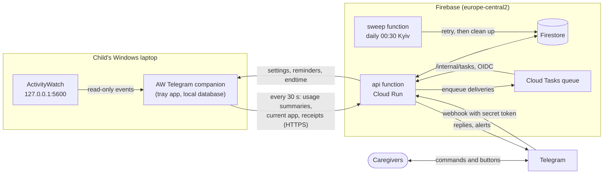

# AW Telegram

Review a child's Windows laptop activity and send reminders through Telegram, built on ActivityWatch.

[](https://github.com/alexandersokol/aw-telegram/actions/workflows/ci.yml)
[](https://github.com/alexandersokol/aw-telegram/releases)
[](LICENSE)

## What it does

AW Telegram lets up to ten authorized parents or caregivers see how a child uses a Windows
laptop and act on it from Telegram. A small companion app runs on the laptop next to
[ActivityWatch](https://activitywatch.net/); a Telegram bot, hosted on Firebase, is the
caregivers' interface. It is built for one family's own laptop and bot, not as a public service.

- **Reports:** today, yesterday and the last seven days. Today and yesterday list application
  names and durations; the week shows daily totals. Status shows whether the laptop is online,
  the current application and the time left.
- **Daily limits with categories:** a daily allowance (a recurring default, or a change for
  today only) counted over the ActivityWatch categories you choose, descendants included.
- **Endtime:** an optional daily time (default 21:00) with warnings on the laptop at 15, 10 and
  5 minutes and a repeating overlay once it is reached.
- **Reminders and overlays:** a notification card or a full-screen dimming overlay with your text,
  shown now or after a delay, optionally with a countdown, a dismiss button or a repeat. Pending
  reminders can be listed and cleared.
- **Free use and clearing:** switch the day's limit off until midnight, or clear reminders
  (manual only, or all) and restore the automatic ones.
- **Up to ten caregivers:** each pairs with a one-time key and sees the same laptop. Changes made
  by one caregiver are reported to the others, and the author is told when the laptop has applied
  the change.
- **Self-removal:** a caregiver can leave with `/unpair`, and the laptop can be retired with
  `aw-telegram.exe --uninstall`.
- **English and Ukrainian** in both the bot (`/language uk|en`, or the Settings choice) and the
  laptop app («Мова / Language»). The app shows its version in Settings.

Times and daily resets use the Europe/Kyiv calendar. An overlay is a reminder, not tamper-proof
enforcement; it cannot be shown while the laptop is off or offline, and showing it over an
exclusive-fullscreen game is not guaranteed (see
[Windows validation](docs/windows-validation.md)).

## How it works



The companion reads ActivityWatch locally and **pulls**: about every 30 seconds it sends a sync
request to the backend, which answers with whatever the caregivers changed (limits, endtime,
reminders). The laptop never accepts inbound connections. A command typed in Telegram therefore
reaches the laptop within roughly 30 seconds, and the laptop applies cached rules on its own
while offline. Telegram messages arrive at the backend by webhook; replies and alerts go out
through a delivery queue that retries failed sends.

## Privacy

- Only aggregated usage leaves the laptop: daily totals per application and category, plus the
  current (or last) application and its latest window title. Raw events, window-title history
  and URLs stay on the laptop.
- The backend keeps seven Kyiv dates of reports; the daily sweep deletes older data.
- Message text, including reminder text, is cleared from the backend after 24 hours.
- No service-account key is created or stored anywhere. The backend runs as its own service
  account and reads secrets from Secret Manager.
- Telegram and Google Cloud are part of the trust boundary. Bot messages are not end-to-end
  encrypted, and an authorized caregiver can forward or photograph a report. Replies containing
  titles stay in the Telegram chat history regardless of backend retention.

Details: [requirements](docs/user-requirements.md) and
[enrollment security](docs/enrollment-security.md).

## Setup for owners

You need a Google Cloud/Firebase project on the Blaze plan (the expected cost is small; see the
[hosting cost estimate](docs/hosting-cost-estimate.md)), a Telegram bot from
[BotFather](https://t.me/BotFather), and a Windows laptop with ActivityWatch installed.

1. **Prerequisites.** Install Node.js 22, the Google Cloud CLI (`gcloud`) and, to build the
   companion yourself, python.org Python 3.12. Sign in with `gcloud auth login` and
   `gcloud auth application-default login`. Everything runs with your own credentials.
2. **Create the cloud project.** Enable the APIs, create the Firestore database, the two
   service accounts and the `delivery` queue, and deploy the Firestore rules and indexes. Exact
   commands: [docs/setup.md](docs/setup.md).
3. **Store the secrets.** Put the BotFather token and a random webhook secret in Secret Manager,
   at a hidden prompt; they never appear in files or command arguments. See *Secrets* in
   [docs/setup.md](docs/setup.md).
4. **Deploy.** Install the bot's dependencies (`npm ci` in `bot/`), then deploy the functions
   twice: the first deploy discovers the `api` URL, which you put in `bot/.env.<project-id>` as
   `BACKEND_URL` (model: `bot/.env.example`) before the second. See *Deploying* in
   [docs/operations.md](docs/operations.md).
5. **Register the webhook.** Run `node --experimental-strip-types bot/scripts/webhook.ts set
   --project <project-id> --url <BACKEND_URL>/telegram/webhook` from the repository root, then
   `info` to check it. This also registers the bot's command menu. See
   [docs/operations.md](docs/operations.md).
6. **Get the companion.** Download `aw-telegram-<version>-windows.zip` from the
   [Releases page](https://github.com/alexandersokol/aw-telegram/releases) and unzip the
   folder, or build it yourself as described in
   [docs/setup.md](docs/setup.md#companion-laptop). The build is not code-signed, so Windows
   SmartScreen warns on first run.
7. **Enroll the laptop.** After `npm run build` in `bot/`, issue a one-time code with
   `scripts/enroll.ts issue` (command in
   [docs/enrollment-security.md](docs/enrollment-security.md)), start `aw-telegram.exe` on the
   laptop and paste the code in Settings («Налаштування»). Tick "start with Windows" so it runs
   in the background. Steps: [docs/setup.md](docs/setup.md#companion-laptop).
8. **Pair the caregivers.** In Parent access («Доступ батьків»), create a key for each
   caregiver. Each caregiver sends the shown `/pair` command to the bot in a private chat within
   15 minutes.

Day-two tasks (rotating secrets, recovering a lost laptop, deleting data, rollback) are in
[docs/operations.md](docs/operations.md).

## Using the bot

After pairing, `/start` opens the main menu, with buttons for usage, laptop status, reminders,
the time limit and settings. Every reply without buttons carries «🏠 Головне меню» to return to
the menu, and the bot registers a short command menu in Telegram. The commands you will use most:

| Command | What it does |
|---|---|
| `/start` | main menu |
| `/usage` | today, yesterday, last seven days |
| `/status` | laptop status |
| `/limit` | the time limit (a duration, for today or as the daily default) |
| `/free on\|off` | free use until midnight |
| `/notify`, `/overlay` | a notification or on-screen message, now or after a delay |
| `/pending` | active and scheduled reminders |
| `/clear` | clear reminders (manual, or all) |
| `/endtime` | endtime status; `set HH:MM`, `on`, `off` |
| `/settings` | hourly reports, endtime, language, help, disconnect |
| `/language uk\|en` | the bot's language for you |
| `/unpair` | disconnect from the laptop |
| `/help` | all commands |

Every command and menu is in [docs/bot-navigation.md](docs/bot-navigation.md); the requirements
are in [docs/user-requirements.md](docs/user-requirements.md).

## Development

### Layout

| Path | Contents |
|---|---|
| `bot/` | Firebase Functions backend and Telegram bot (TypeScript, Node 22); owner CLIs in `bot/scripts/` |
| `companion/` | Windows companion app (Python 3.12, PySide6); `companion/tools/` holds release and license tooling |
| `contracts/` | JSON schemas and fixtures shared by both sides ([contracts/README.md](contracts/README.md)) |
| `docs/` | requirements, design, operations runbook, validation evidence and the implementation plan |
| `.github/workflows/` | `ci.yml` and `release.yml` |
| `VERSION` | the release line, `MAJOR.MINOR` |

### Toolchain

Node 22, Python 3.12 (Windows x64 for the companion) and Java 21 for the Firestore emulator
suites. Design and decisions: [docs/technical-design.md](docs/technical-design.md).

### Tests

Bot, from `bot/` (`npm ci` first; in Windows PowerShell, `npm.cmd` avoids the script
execution-policy block):

```powershell
npm test
npm run build
npm run check:bundle
npm run test:emulator -- auth pairing rules sync delivery purge cleanup
```

`npm test` is the unit suite, including the in-process end-to-end scenarios. The emulator
suites need Java 21 on `PATH` (and `JAVA_HOME`); the Firebase CLI downloads the Firestore
emulator on first use. Run one emulator suite at a time: they share a port.

Companion, from `companion/`, in a virtual environment made from Python 3.12 on Windows:

```powershell
python -m venv .venv
.venv/Scripts/python.exe -m pip install -r requirements.lock
.venv/Scripts/python.exe tools/licenses.py check
.venv/Scripts/python.exe -m pytest -q
```

The suite takes a few minutes and includes a cross-process end-to-end test
(`tests/test_e2e_simulated.py`) that builds and serves the real bot backend on loopback, so it
also needs Node and `npm ci` in `bot/`. Do not set `QT_QPA_PLATFORM=offscreen`; some tests need
a real window. More in [companion/README.md](companion/README.md).

### Contracts

The checked-in schemas in `contracts/v2/` and the copies packaged with the companion are
generated. After changing a definition, regenerate and commit both, from the repository root:

```powershell
python contracts/generate_schemas.py
```

`contracts/v1/` is an immutable archive and is never regenerated.

### Building the companion

A hand build uses a separate virtual environment from python.org CPython 3.12 and PyInstaller.
The commands, the license texts the build requires and the self-check are in
[docs/setup.md](docs/setup.md#companion-laptop). A local build reports version `0.0.0-dev`.

### CI and releases

- [`ci.yml`](.github/workflows/ci.yml) runs on every push and pull request: the bot's unit tests,
  build, bundle check and emulator suites on Ubuntu, and the companion's license check and tests
  on Windows. Deploy only a commit whose run is green.
- [`release.yml`](.github/workflows/release.yml) runs on pushes to `main` that change
  `companion/**`, `contracts/**` or `VERSION`. It re-checks the code, builds the companion,
  requires its self-check to report the new version, and publishes tag `v1.0.x`, release `1.0.x`,
  the zip and a patch of the changes. `x` is one more than the highest `v1.0.*` tag. Docs-only
  and bot-only commits release nothing. Run it from the Actions tab with `dry_run` ticked (the
  default) to build and verify without publishing.
- **Bumping the version:** edit `VERSION`, for example from `1.0` to `1.1`; the next release is
  `1.1.0`. The release stamps `_version.py` and `pyproject.toml` itself; do not edit them.

## Contributing

Issues and pull requests are welcome. Keep changes small and focused, add tests with them and
make sure the checks under *Tests* pass; CI runs the same ones. Read the requirements and the
relevant design document in [docs/](docs/) before changing behaviour, and write commit messages
in the conventional style used in the history (`feat:`, `fix:`, `docs:`, `ci:`, `test:`).

## Security

Please do not report vulnerabilities in public issues. Use the repository's private
vulnerability reporting (Security tab, "Report a vulnerability") if it is enabled; otherwise
contact the maintainer through [the GitHub profile](https://github.com/alexandersokol).
Credentials, tokens and webhook secrets must never be committed; `.env` files and
service-account keys are git-ignored. Some cloud hardening is not yet done, such as reducing
the permissions of Google's default build account (see [docs/setup.md](docs/setup.md)).

## License

[MIT](LICENSE), copyright (c) 2026 alexandersokol. The Windows build bundles third-party
components under their own terms; their texts ship in `companion/licenses/` and in the built
folder.

## Acknowledgements

- [ActivityWatch](https://activitywatch.net/), the open-source activity tracker this project
  reads from.
- [Qt for Python (PySide6)](https://doc.qt.io/qtforpython-6/), used under the LGPL-3.0; its
  license texts are in `companion/licenses/`.
- [grammY](https://grammy.dev/), Firebase and the Telegram Bot API.
