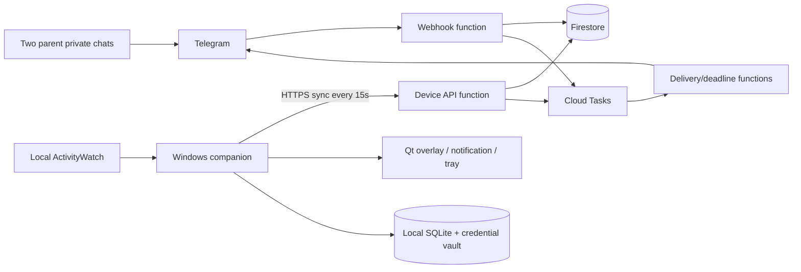

# AW Telegram technical design

Date: 2026-10-27. Status: technical design approved by the owner.
No application implementation or deployment has occurred. User behavior is defined
by user-requirements.md, bot-navigation.md, and companion-navigation.md. This design
resolves implementation choices; it does not silently replace agreed behavior.

## Goal and boundaries

One Windows laptop, up to two paired parent accounts, private Telegram chats only.
Ukrainian built-in text; unchanged English command names. Today/yesterday category
reports and seven-day daily totals, text only. Keep today plus six previous Kyiv
calendar dates. No historical import, Android, app breakdowns, graphs, remote shell,
computer locking, or tamper protection. Allow minimizing a game to reveal overlays.

## Approaches and chosen direction

The discussion selected a separate companion plus hosted Firebase webhook backend.
Changing ActivityWatch/aw-notify would couple installation to particular AW releases;
we will instead consume existing localhost APIs. Direct companion-to-Firestore access
would require a second authorization surface; all device traffic goes through our
HTTP API. A polling Telegram bot on a VM would require a running server; use
Telegram webhooks and short-lived functions instead. SQLite is local state only,
not cloud storage. We will not require aw-notify: its optional installation, native
notification suppression, and lack of controllable overlays conflict with our UI.

## Stack and deployment choices

| Area | Decision |
|---|---|
| Bot/backend | TypeScript strict mode, Node.js 22, Firebase Functions v2 |
| Telegram | grammY webhook adapter; no bot.start()/long polling |
| Cloud state | Firestore Standard, one database, deny all direct client access |
| Background reliability | Cloud Tasks for outbox delivery and command deadline checks |
| Cleanup | One daily Cloud Scheduler function after Kyiv midnight |
| Region | europe-west1 for functions/tasks and regional Firestore; co-locate |
| Companion | Python 3.12, PySide6 Qt Widgets, requests, sqlite3, zoneinfo + tzdata |
| AW queries | aw-client query builder with explicit parameters and configured client |
| Windows integration | ctypes Win32 APIs; keyring Windows credential backend |
| Packaging | PyInstaller one-directory bundle, zipped portable first release |
| Tests | pytest/pytest-qt; Vitest; Firebase emulators; shared JSON fixtures |

Resolve exact dependency patch versions at implementation and commit lockfiles.
Do not inherit the root .tool-versions (Node 16/Python 3.9). Qt licensing notices
and redistribution obligations belong in the bundle. No native service, browser
UI, Docker, or additional database is needed. Mac can run bot/core/Qt tests;
Windows packaging and fullscreen acceptance require the actual laptop.

## Components and data flow

No inbound port on the laptop. No public ActivityWatch endpoint. The companion
samples AW every 10 seconds, sends a heartbeat/command exchange every 15 seconds,
and includes freshly calculated summaries at least every 30 seconds while healthy.
Aim at the agreed one-minute report freshness and 30-second command target.
Use worker threads for IO; only the Qt main thread changes widgets.

## Shared contract and cloud documents

Create contracts/v1/*.schema.json and fixtures/ for both language implementations.
Use UTC ISO timestamps on the wire, integer milliseconds for durations, category
paths as arrays of exact original segments, and Europe/Kyiv dates as YYYY-MM-DD.
Represent uncategorized with a reserved category ID, not a translated label.
Sync responses include nullable collectionStartedAt; before first pairing it
is null and activity collection/upload is disabled. All requests have schemaVersion=1; reject unsupported versions and unknown fields
on security-sensitive envelopes. Limit request bodies to 128 KiB and messages to
1000 characters. Paginate Telegram output below its message limit and escape HTML.

Documents (all scoped under devices/{deviceId} except global lookup collections):

- devices/{id}: enrolledAt, name, status timestamps, enrollment state, credential
  digest, current settings version, collectionStartedAt (first successful parent pairing). Never store plaintext device credentials.
- devices/{id}/settings/current: revision, selected category paths, 14400000 ms
  recurring allowance, today-only allowance/date, freeUseDate, suppressedDate.
  Initially select no categories: setup asks the parent to choose, never guesses
  translated category names or silently applies four hours to everything.
- devices/{id}/days/{date}: leaf-category totals, selected total, availableFrom,
  availableThrough, partial/coverage flags, rules revision, snapshot sequence.
  Reports show disjoint leaf totals (no duplicated parent rollups). Week reports
  include total active time and selected-category time per date and overall.
- devices/{id}/live/current: latest app/title and observedAt, active/AFK/unknown,
  resolved foreground category, category catalog without rule regexes/URLs.
  Replace this single title in place; never copy titles into snapshots/audit logs.
- devices/{id}/parents/{telegramUserId}: private chat ID, key label, hourlyEnabled
  (initially false), joinedAt, revocation state. Telegram IDs are decimal strings.
- pairKeys/{sha256(secret)}: deviceId, name, expiresAt, consumedBy; no plaintext.
- enrollments/{sha256(secret)}: expiry, consumedAt, allowed device count=1.
- telegramUsers/{userId}: deviceId binding (one laptop in this version).
- devices/{id}/actions/{uuid}: actor, kind, bounded message/options, targetAt,
  expiresAt, delivery count, sequence, settings revision, state, presentation state.
- telegramUpdates/{updateId}: processing state/lease and logical side-effect IDs;
  transactional resume after crashes, not a permanent 'seen' marker before work.
- outbox/{eventId}: recipient, templated payload/reference, attempt state/lease,
  nextAttemptAt, Telegram message ID if available. Latest-title replies are not
  persisted as outbox payloads: resolve live data at send time.
- devices/{id}/alertState/{date}: per-parent delivered milestone high-water marks,
  allowance warning state keyed by settings revision and event IDs.
- devices/{id}/sessions/{userId}: menu step, draft, nonce/version, expiresAt.

Keep action/session/update/outbox documents no longer than seven local dates;
completed message content should be cleared after 24 hours. Pending future timers
are bounded to less than 24 hours. Parent/settings credentials persist until
revoked; they are not report history. Strict report reads exclude older dates even
before physical cleanup. A midnight cleanup deletes old reports/state without
Firestore TTL; TTL is billable and may lag. Actual physical deletion can lag during
outages; document that limitation. Overwrite live data without retaining revisions,
disable backups/PITR and request-body logging. Providers may retain infrastructure
copies under their policies; no claim of cryptographic deletion or Telegram erasure.

## Authentication, enrollment, and pairing

Deployment uses the owner's Google account with MFA and least-privilege IAM. A
setup CLI running on the owner's machine creates a 32-byte random one-time
laptop enrollment secret (15-minute lifetime). The copied enrollment bundle includes
an HTTPS backend URL and secret. The companion displays the backend host before
sending it. Exchange it transactionally for a random 32-byte device bearer secret;
store that only in Windows Credential Manager and its SHA-256 digest in Firestore.
No admin SDK credentials or Telegram bot token on the laptop.

The enrolled companion requests a named parent key (16 random bytes, base64url,
single-use, expires after 15 minutes). /pair validates private chat and consumes
it transactionally, binding to the numeric sender ID and private chat ID. Cap at
two parents, including concurrent pairing attempts. Labels are descriptive only.
Show plaintext key once, then only label/account/status. Remove access atomically,
clear pending sessions, recheck authorization on every callback/command/send, and
prevent outbox sends after revocation. Paired access has no inactivity expiry.
Local revocation becomes effective remotely after backend acknowledgement.

Require Telegram X-Telegram-Bot-Api-Secret-Token on the webhook. Store bot token
and webhook secret in Secret Manager. Reject groups, inline/business/channel
contexts, and unauthorized callbacks before any data access. Buttons use opaque
session-bound IDs, never trust embedded device/user IDs. Protect pairing/enrollment
with persistent per-sender/IP throttles and generic errors; do not log secrets.
Device API authenticates each call, validates all payloads, limits range to enrollment
through current retained dates, and never lets the device choose parent recipients.
Task handlers require the queue service identity/OIDC, not an unprotected URL.
Direct Firestore rules deny all client reads/writes; server IAM still applies.

## ActivityWatch integration and counting

Probe /api/0/info, buckets, settings, query API against the installed AW version.
Discover local window/AFK bucket IDs by metadata; exclude imported/synced buckets.
If ambiguous, offer a companion selection instead of guessing. Use loopback by
default and support the AW API key when configured; no calls to the son's LAN URL
from the backend. Read category settings through the configured client, not
aw_client.classes.get_classes()'s implicit default-server connection.

Build canonical events using explicit classes, filter_afk=true,
include_audible=false, always_active_pattern=None and exact bucket IDs. Check
browser enrichment compatibility locally without adding background audible time.
Resolve effective category-set precedence consistently with installed web UI;
missing/unsupported settings trigger a setup error or explicit uncategorized
state, never an unnoticed replacement by library defaults. Port the minimal
category-settings normalization with fixtures, not an entire UI dependency.

Clip to [collectionStartedAt, now] and Kyiv local day. Intersect foreground events with
not-AFK intervals, reject invalid durations, sort/union overlaps so each instant
counts once. Clamp the open tail to real heartbeat freshness; never extend stale
samples through sleep. Aggregate disjoint leaf category totals and calculate the
selected sum using ancestor-path prefix matching. AW rules remain authoritative;
our selections select categories, not modify their rules.

Every 30 seconds recompute today; on reconnect recompute retained dates since last
successful coverage. Never import before the first successful parent pairing. Enrollment alone
does not start report collection; collectionStartedAt is immutable across reconnects
and parent replacement. The companion receives it in its first paired sync. Store only summaries locally,
not title history. Today and backfilled day snapshots overwrite by monotonically
increasing sequence. Cloud rejects older sequences, wrong dates, invalid totals,
and stale settings revisions for selected totals; category leaf totals can still
be retained then selected totals recalculated server-side. Category selection
edits recalculate today immediately using existing leaf totals and confirm again
when a fresh companion snapshot arrives. Missing data remains unknown/partial.

Overlay itself must not cause foreground-category oscillation: exclude companion
windows from counted activity and preserve the last non-companion foreground
identity for overlay gating. If a game is minimized by us, track that action so
our own foreground overlay doesn't immediately hide itself. Observe actual user
switches and AW AFK state; switching to schoolwork hides automatic overlays.
Do not fabricate gaming duration while the companion owns foreground focus.

## Settings and reminders state machines

Cloud owns versioned settings; SQLite caches acknowledged revisions for offline
operation. A transactional settings edit increments revision. Companion ignores
older revisions, persists new settings before acknowledging, and evaluates them
immediately. Concurrent parent edits serialize; confirmations include effective
values/revision and name the actor. Latest committed edit wins, never silently
merges conflicting choices. Personal hourly preferences do not notify the other
parent; shared laptop edits/actions do. Requested reports remain private.

Today-only allowance overrides expire at Kyiv midnight; changing recurring default
replaces today's override. Category selection includes descendants; new selection
recalculates all collected usage today. Daily reset is a function of the current
date, not a timer assumed to fire while asleep. Free-use date and clear-all
suppression date are independent. Auto reminders require both to be inactive;
restore clears only suppression, not free use or canceled manual actions.

A presentation queue does not extend deadlines. Immediate actions must begin
presentation before expiresAt; delayed actions must begin by targetAt+5s during
normal operation. If another manual overlay blocks presentation until that bound,
mark expired with reason display_busy and notify the parents; do not interrupt
an existing manual overlay or replay later. For repeats of an already presented
manual overlay, keep only one pending repeat, show when the overlay slot is free
(before midnight), and never accumulate multiple repeats. Normal notifications
use their own visible slot; newer notification cards replace older ones with an
accurate dismissed/replaced status.

Local scheduler uses UTC deadlines with a monotonic clock for short waits and
reconciles on wake/clock change. Persist actions before acknowledgement. For a
delayed action, show if due within 5 seconds while running normally; on resume
past deadline expire without display. If not yet due, continue original countdown.
Timers created before free use survive if future at re-enable; due-during-free
use actions are skipped, never replayed. New manual commands in free use are
immediately skipped. Dismissible manual default is once; repeating interval starts
on dismissal and ends at midnight. Buttonless duration is mandatory (1–3600s);
manual delays/repeats are 1–1439 minutes. No arbitrary executable/script arguments.

Immediate action lifetime is 60s. Server makes at most three delivery offers,
separated by at least 20s; companion polls every 15s. Persist action ID locally
before display, return receipt/status on next sync and promptly after presentation.
Reject expired offers locally. Crash after recording 'presenting' but before
completion is 'unconfirmed', not replayed automatically (avoid duplicate overlays).
A Cloud Task at 60s closes unconfirmed delivery and informs the issuer and other
parent even if the laptop never reconnects. Already acknowledged/displayed actions
are not failed merely because the timer fires; ambiguous acknowledgements use
'Не вдалося підтвердити доставку'. Scheduled timers have two separate lifecycles: delivery and local execution.
A due-time task expires a timer only if it was never accepted by the companion.
For a previously accepted timer, crossing its deadline without an execution receipt
means execution_unconfirmed, not expired: it may have run correctly offline.
Keep the locally acknowledged timer eligible to run offline at its deadline. On
reconnect, reconcile signed-in-device receipts with acceptedAt/presentedAt/status;
a timely recorded presentation wins over an earlier cloud 'delivery unconfirmed'
notice, and emit a corrected status if needed. A later device receipt for an
already expired undelivered timer can correct uncertainty only when it proves
acceptance/presentation timestamps within the original window; never deliver a
stale command again. Purge still obeys seven-date retention. Manual expiry/skip/
failed status comes from the local scheduler when available, not inference from
silence. Parents see 'Очікуємо підтвердження виконання' for accepted offline timers.

Clear commands/settings are durable control changes, not ephemeral reminders.
A revisioned cancellation fence plus explicit canceled IDs stops current/pending
manual actions across reconnects; a request acknowledgement is distinct from a
confirmed local clear. Clear all also suppresses automatic reminders until midnight.
Presentation ordering: one overlay at a time, manual before automatic, FIFO for
simultaneous manual actions; all countdowns/notifications are separately tracked.
A visible manual overlay pauses automatic presentation, not time accounting.

## Alerts, Telegram delivery, and menus

At 15/10/5 minutes remaining and expiry, both parents receive allowance alerts
unless suppressed. Local warnings can continue offline; cloud alerts can only use
received data and include freshness. On catch-up/limit edits emit one most relevant
current warning, not all missed thresholds. Deduplicate by date/revision/threshold;
new edits may emit one current-state update but must not spam identical warnings.
Hourly updates use selected totals, per-parent preferences, independent of suppression.
Send one latest total after catch-up; enabling starts with the next threshold;
category edit informs both with current total and preserves delivered high-water marks.

Use a Firestore transaction for domain mutation + outbox creation, then dispatch
via Cloud Tasks. One retryable worker processes recipient messages with leases,
Telegram rate-limit backoff, and recipient authorization rechecks. A daily sweeper
re-enqueues stranded unsent outbox entries; active device sync also repairs them.
Telegram sendMessage has no general idempotency key: a crash after Telegram accepts
but before saving response may duplicate a Telegram message. Document this honest
at-least-once limitation; laptop actions still deduplicate separately. Do not claim
exactly-once Telegram delivery. Treat 403 (parent blocked bot) as undeliverable and
continue the other parent's delivery without revoking their data accidentally.

Persist menus/drafts per parent with a 30-minute timeout and nonce. Stale buttons
ask to reopen menu; duplicate updates/callbacks cannot enqueue duplicate actions.
Use the agreed button tree, 5/10/15/30 minute presets + custom input and review before
submission. Command spellings: /start, /pair, /help, /status, /settings,
/usage [today|yesterday|week], /categories, /add_category, /remove_category,
/limit [duration today|daily], /notify, /overlay, /pending,
/clear manual|all, /restore, /free on|off, /hourly on|off.
Parse notification options before the remaining plain-text message and reject
conflicting repeat/no-dismiss options. No Markdown interpretation of parent text.

## Overlay and notifications

Qt frameless topmost tool window painted per-pixel: black alpha 0.70 background,
opaque centered white text, wrapped, primary-screen geometry in device-independent
coordinates. Bottom-centered «Закрити» with edge margin; capture all mouse clicks,
never pass through. Keep a transparent background attribute rather than whole-window
opacity so text remains opaque. Track display/primary-screen/DPI changes.

Use a small companion-controlled Qt notification card for /notify and advance
warnings, with a 10-second default lifetime and clearable IDs. This is preferable
to native toast dependence: primary-monitor targeting and clearing remain under our
control. It is a desktop notification distinct from the dimming overlay. Show
countdowns in a separate top-left primary-screen widget. No keyboard hooks.

Try topmost presentation, then permitted minimization of a primary-monitor fullscreen
foreground app using Win32 ShowWindowAsync when required. Do not minimize unrelated
windows or elevated/system dialogs, inject into games, disable anti-cheat, or loop
stealing focus. Log result metadata only; report presentation unconfirmed if OS
blocks it. Capture foreground app/category before presentation for activity gating.
Fullscreen acceptance against the actual games is an early gate: no general Windows
API guarantee can be made from a Mac. Secure desktop/UAC is outside scope.

## Cost and operation

Functions minInstances=0, maxInstances=2 per public handler initially; 256 MiB
for light HTTP workers, task workers bounded similarly. Review actual cold-start
latency against targets. With eight active hours, 15s polling is ~1920 device calls/day,
~960 summary updates/day at 30s, plus bot commands/tasks. Idle polls should avoid
Firestore writes unless heartbeat cadence or action state changes; batch fetch state
and pending actions, avoid scanning histories. Emulator tests count operations;
these estimates are not a free-bill guarantee.

Use one cleanup scheduler plus task queue; include Scheduler/Tasks/Secret Manager,
Artifact Registry/build/log/network costs in deployment checklist. Set budget alerts
and supported service spend caps, max-instance and input rate limits, artifact
cleanup, no sensitive logging. No Firebase Hosting/custom domain needed. Owner
manually deploys; no auto-updater in v1. Back up deployment configuration, not raw
activity. Provide device revocation and purge CLI with explicit scope.

## Validation and release gates

1. Domain tests use shared fixtures across Python/TS: DST, overlap, category edits,
   free-use/clear precedence, missed deadlines, duplicates, two-parent races.
2. Firebase emulator integration: enrollment/pairing race, invalid credentials,
   revoked callbacks/outbox, malformed data, atomic actions/outbox, task authorization.
3. Local AW fixtures and real version probe: canonical strict-active categories,
   no pre-enrollment data, missing buckets, stale heartbeat, no default-host leakage.
4. Windows gate early: signed-in desktop, exclusive/borderless games, minimize
   fallback, DPI/multi-monitor primary-only capture, dismiss/repeat, AFK switching.
5. End-to-end staging with two parent accounts: reports while laptop off, one-minute
   expiration with laptop off, offline local limits, wake/restart, seven-date pruning,
   no title/secret history in storage/logs. Run from a standard Windows account.

## Sources checked for this design

- [Firebase supported runtimes and scaling](https://firebase.google.com/docs/functions/manage-functions)
- [grammY Firebase webhook adapter](https://grammy.dev/hosting/firebase)
- [Firebase task functions](https://firebase.google.com/docs/functions/task-functions)
- [Scheduled functions](https://firebase.google.com/docs/functions/schedule-functions)
- [Firestore TTL delay and cost](https://firebase.google.com/docs/firestore/ttl)
- [Qt tray support](https://doc.qt.io/qtforpython-6/PySide6/QtWidgets/QSystemTrayIcon.html)
- [Windows foreground restrictions](https://learn.microsoft.com/en-us/windows/win32/api/winuser/nf-winuser-setforegroundwindow)

Local reference: aw-client/aw_client/queries.py, aw-client/aw_client/classes.py,
aw-notify/src/main.rs and the web UI category store. Installed version compatibility
must be verified rather than inferred from this checkout alone.

### Polling cost validation

See [hosting-cost-estimate.md](hosting-cost-estimate.md) for current free allowances,
4/8/24-hour polling estimates, CPU assumptions, and account-wide quota caveats.
Keep polling responses short; the 15-second wait is on the laptop. Add exponential
backoff on failures, indexed bounded pending-action reads, and operation accounting
in integration/staging checks. Alert evaluation runs on changed summaries/settings,
not empty polls, and empty polls must not enqueue Cloud Tasks. Validate measured
costs before claiming routine operation fits included allowances.
